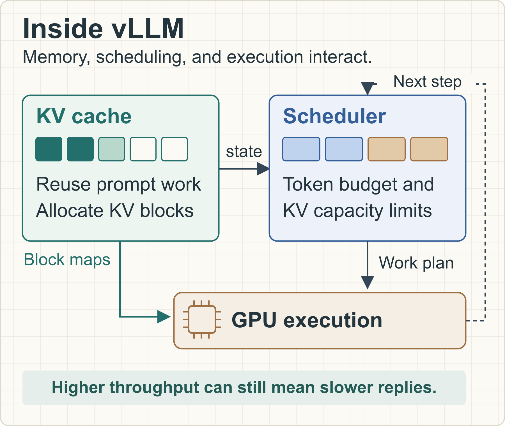

# Kaan Boke

**Senior AI and Machine Learning Engineer | Finland**

I work on AI and machine learning systems, with a focus on how applications are designed, evaluated, and operated.

- **AI system architecture:** connecting models, data, tools, and application logic, with clear responsibilities and access boundaries.
- **AI evaluation & reliability:** trace and error analysis, task outcomes, regression checks, and evidence for release decisions.
- **Inference engineering:** exploring how memory, scheduling, and GPU execution affect serving capacity and response time.

My professional AI projects are private. Below, you can inspect my earlier public implementations and read my current AI engineering explanations.

## Selected Engineering Projects

Public code spanning model training, data processing, experiment tracking, and deployment automation.

### [Model training & serving on AWS SageMaker](https://github.com/kb1907/AWS_Sagemaker)

A random-forest example covering S3 data upload, training through the SageMaker Python SDK and Boto3, hyperparameter tuning, endpoint deployment, and prediction requests.

**Start with the code:** [Training and serving notebook](https://github.com/kb1907/AWS_Sagemaker/blob/main/AWS_Sagemaker_House_Prediction/AWSSagemaker_House_Prediction.ipynb).

### [Data processing & ML with PySpark](https://github.com/kb1907/PySpark_Projects)

Feature assembly, reusable ML pipelines, three-fold cross-validation, and regression evaluation. A companion SQL notebook covers joins and grouped aggregations.

**Start with the code:** [Random-forest pipeline](https://github.com/kb1907/PySpark_Projects/blob/main/PySpark_RandomForest_Model/PySpark_with_RF_Car_Price.ipynb) · [Spark SQL analysis](https://github.com/kb1907/PySpark_Projects/blob/main/PySparkSQL_Project/PySparkSQL_Project_Listening.ipynb).

### [Experiment tracking & model deployment](https://github.com/kb1907/mlflow-aws-sagemaker)

CatBoost training with MLflow parameter, metric, and model logging, alongside separate SageMaker deployment and endpoint-invocation scripts.

**Start with the code:** [Training and tracking](https://github.com/kb1907/mlflow-aws-sagemaker/blob/main/aws-mlflow-exp.py) · [Deployment](https://github.com/kb1907/mlflow-aws-sagemaker/blob/main/deploy.py) · [Endpoint client](https://github.com/kb1907/mlflow-aws-sagemaker/blob/main/sagemaker-predict.py).

### [Container packaging & CI/CD](https://github.com/kb1907/GithubActions-DockerHub-CICD-Tutorial)

A Flask prediction app with Docker packaging and a GitHub Actions workflow defining linting, a prediction test, and image build/push stages.

**Start with the code:** [Application](https://github.com/kb1907/GithubActions-DockerHub-CICD-Tutorial/blob/main/app.py) · [Dockerfile](https://github.com/kb1907/GithubActions-DockerHub-CICD-Tutorial/blob/main/Dockerfile) · [CI/CD workflow](https://github.com/kb1907/GithubActions-DockerHub-CICD-Tutorial/blob/main/.github/workflows/github-docker-cicd.yaml).

These are earlier learning and implementation projects; their dependencies and deployment instructions reflect their original environments.

## AI Engineering Writing

I share the reasoning behind AI system behavior, architecture choices, and evaluation methods through articles and diagrams.

### [Inside vLLM: how the serving engine fits together](https://kaanboke.substack.com/p/inside-vllm-how-the-serving-engine)

How memory allocation, prefix caching, scheduling, and GPU execution interact, and why higher throughput can still mean slower replies. Includes a worked serving example.

View the vLLM engine diagram

*Simplified overview of the vLLM engine loop. Select the diagram to read the article.*

### [AI system evaluation: beyond the response](https://www.linkedin.com/feed/update/urn:li:activity:7521104073664729088/)

Checking whether an application actually completed the requested action, with explicit deadlines, unknown outcomes, and regression checks.

### [AI system architecture: Who owns your business definitions?](https://www.linkedin.com/feed/update/urn:li:activity:7517986079417868288/)

Connecting approved business definitions, AI context, controlled query tools, and evaluation so an assistant and a dashboard use consistent meaning.

## Earlier Projects & Learning Resources

Browse more projects and course notes

### Machine Learning & Data

- [Machine Learning Projects](https://github.com/kb1907/Machine_Learning_Projects)
- [Deep Learning Projects](https://github.com/kb1907/Deep_Learning_Projects)
- [NLP Projects](https://github.com/kb1907/NLP_Projects)
- [Time Series Projects](https://github.com/kb1907/Time_Series_Projects)
- [Data Science Projects & Exploratory Analysis](https://github.com/kb1907/Data_Science_Projects)
- [Web Scraping Projects](https://github.com/kb1907/Web_Scraping_Projects)

### Deployment & Workflow Tooling

- [Airflow](https://github.com/kb1907/airflow-local)
- [AWS Elastic Beanstalk & GitHub Actions](https://github.com/kb1907/Model-Deployment-AWS-Beanstalk)
- [Kubernetes, Flask & Docker](https://github.com/kb1907/Kubernetes-Flask)
- [FastAPI, Heroku & GitHub Actions](https://github.com/kb1907/FASTAPI-CI-CD-HEROKU-GITHUB-ACTIONS)
- [Locust & Flask](https://github.com/kb1907/Locust-Flask)

### Course Projects & Notes

- [Generative AI with Large Language Models](https://github.com/kb1907/Generative-AI-with-Large-Language-Models)
- [Deep Learning Specialization](https://github.com/kb1907/Deep-Learning-Specialization)
- [Natural Language Processing Specialization](https://github.com/kb1907/Natural-Language-Processing-Specialization)
- [Practical Data Science on the AWS Cloud](https://github.com/kb1907/Practical-Data-Science-Specialization)
- [Kaggle Notebooks](https://www.kaggle.com/kaanboke)

## Writing & Contact

[LinkedIn](https://www.linkedin.com/in/kaanboke/) · [Substack](https://kaanboke.substack.com/) · [Medium](https://medium.com/@kaanboke)
